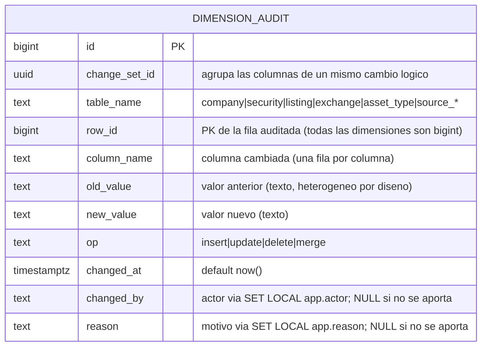
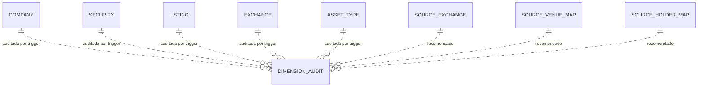

# Modelo de entidades — Log de correcciones de dimensiones (`DIMENSION_AUDIT`)

Cuarta y última pieza del **normalizador**. Infraestructura transversal: una sola tabla, externa a las dimensiones (no las toca estructuralmente). Ver decisiones en `decisiones-modelo-auditoria.md`.

> **Polimórfica a propósito.** `table_name` + `row_id` + `column_name` identifican la celda cambiada en cualquier dimensión. No hay FK (ni entrantes ni salientes): es el anti-patrón polimórfico aceptado como **excepción consciente** por ser infraestructura sin referencias (ver decisiones §2). Ninguna otra tabla cuelga de ella.

## Relación con el resto del modelo (conceptual, no FK)

Líneas punteadas = relación **lógica por trigger**, no FK real (`table_name`+`row_id` son texto/bigint sueltos). Las tablas de **hechos** NO aparecen: conservan su propio historial (bitemporal / snapshot-temporal / append-only).

## Grano y mecanismo (resumen)

| Aspecto | Decisión |
|---|---|
| **Grano** | Una fila por **columna cambiada**. `UPDATE` de 3 columnas → 3 filas con el mismo `change_set_id`. |
| **Población** | Trigger `AFTER INSERT/UPDATE/DELETE` en las tablas auditadas (compara OLD vs NEW, escribe solo lo que cambió). |
| **Contexto** | `changed_by`/`reason` vía variables de sesión (`SET LOCAL app.actor`, `app.reason`); NULL en correcciones SQL directas. |
| **Fusión** | Filas `op='merge'` (re-apuntado de `SECURITY.company_id`) + `delete`/desactivación de la COMPANY sobrante, unidas por `change_set_id`. |

## Qué audita

- **Sí (v1):** `COMPANY`, `SECURITY`, `LISTING`, `EXCHANGE`, `ASSET_TYPE`, `ETF_PROFILE`, `SECTOR`, `INDUSTRY`, `VALIDATION_RULE`.
- **Recomendado:** `SOURCE_EXCHANGE`, `SOURCE_VENUE_MAP`, `SOURCE_HOLDER_MAP` (dimensiones mutables de referencia).
- **No:** tablas de hechos (ya son históricas por diseño).

## Pendiente / verificar

- Dominio exacto de `op`; si `merge` merece tabla propia de eventos de fusión (probablemente no en v1).
- Retención del propio audit-log (probablemente para siempre: barato y es el registro de integridad).
- `change_set_id` como `uuid` generado por la aplicación o `bigint` de secuencia — decidir al implementar el trigger.
