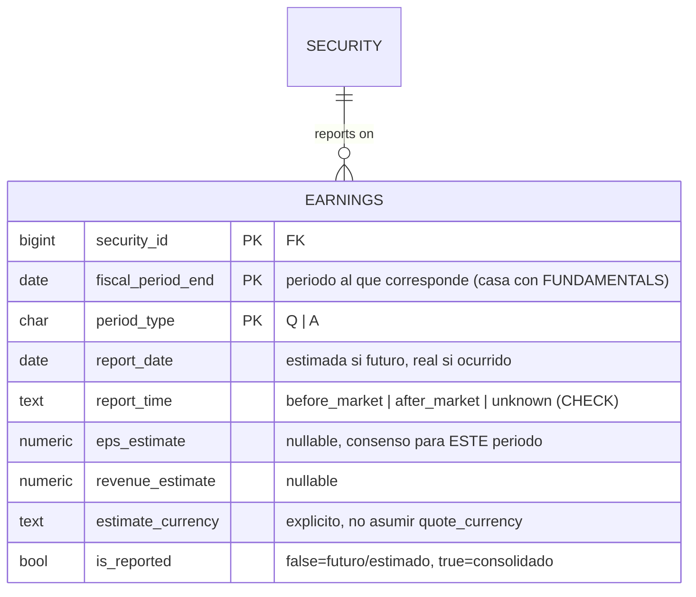

# Modelo de entidades — Earnings (calendario de resultados)

Continúa `modelo-entidades.md` (núcleo). Tercer evento corporativo junto a STOCK_SPLIT/DIVIDEND. Cuelga de `SECURITY`. Ver decisiones en `decisiones-modelo-earnings.md`.

## Notas por entidad

| Entidad | Cuelga de | PK / UNIQUE | Patrón temporal |
|---|---|---|---|
| **EARNINGS** | SECURITY | natural `(security_id, fiscal_period_end, period_type)` | Hecho-puntual **mutable-hasta-consolidar**: UPSERT en sitio mientras es futuro (la estimación cambia), se congela al reportarse. Solo último estado en v1. |

**PK natural (regla 1.b):** la clave `(security_id, fiscal_period_end, period_type)` es limpia (sin string libre) → PK natural directa, como `OWNERSHIP_SNAPSHOT`/`ANALYST_CONSENSUS`/`SHORT_INTEREST`. El UPSERT-en-sitio no justifica `id` sintético: esas tres también se actualizan por clave natural.

**Por qué per-SECURITY y no per-COMPANY:** el EPS estimado es per-share → por clase de acción, misma frontera que el EPS real (absoluto en COMPANY, per-share en SECURITY).

**Diferencia con DIVIDEND/STOCK_SPLIT:** esos son append-only inmutables; EARNINGS se actualiza en sitio hasta consolidar. No asumir append-only.

## Derivados (NO en la fuente de verdad)

- **EPS/revenue real (actual)** = de FUNDAMENTALS del mismo `(security, fiscal_period_end, period_type)`. No se guarda en EARNINGS.
- **Sorpresa (surprise %)** = `(eps_real − eps_estimate) / |eps_estimate|` (EARNINGS.eps_estimate × EPS real derivado de FUNDAMENTALS).
- **Próximo earnings** = fila con `is_reported = false` y `report_date >= today`, la más próxima.

## Pendiente / verificar en vivo

- Shape de la sección Earnings de EODHD (campos, before/after market, estimado por periodo).
- Que `fiscal_period_end` de earnings use el mismo criterio de cierre que FUNDAMENTALS (join por periodo).
- Promoción a snapshot-temporal (histórico de revisiones del estimado) si aparece requisito.
