# Modelo de entidades — ETFs

Continúa la fuente de verdad. Identidad del ETF = Opción B (`SECURITY.company_id NULL`, invariante `ASSET_TYPE.requires_company` enforcado por trigger — no CHECK, ver `decisiones-modelo-etf.md` §1). Las cuatro tablas cuelgan de `SECURITY`. `ETF_HOLDING.constituent_security_id` es un FK opcional a otra `SECURITY` del núcleo.

```mermaid
erDiagram
  SECURITY ||--o| ETF_PROFILE : "is an ETF"
  SECURITY ||--o{ ETF_NAV_DAILY : "nav series"
  SECURITY ||--o{ ETF_HOLDING : holds
  SECURITY ||--o{ ETF_ALLOCATION : "exposure as of"
  SECURITY |o--o{ ETF_HOLDING : "is constituent of"

  ETF_PROFILE {
    bigint security_id PK "FK, 1:1"
    text issuer "gestora (texto v1 = gancho a Opcion C)"
    date inception_date
    text index_tracked
    text category "asset_class"
    text domicile
    numeric expense_ratio "dimension; historial via log de correcciones (pendiente global, mecanismo sin decidir); candidato a serie futura"
  }

  ETF_NAV_DAILY {
    bigint security_id PK "FK"
    date date PK
    numeric nav
    text nav_currency "explicito"
    numeric aum "net_assets"
    numeric shares_outstanding_etf "creation/redemption, NO bitemporal"
  }

  ETF_HOLDING {
    bigint id PK
    bigint security_id FK "el ETF"
    date as_of_date "snapshot-temporal, historico conservado"
    bigint constituent_security_id FK "a SECURITY del nucleo si esta; NULL -> fallback"
    text constituent_isin "fallback identidad"
    text constituent_name "fallback / display"
    numeric weight_pct "NOT NULL: define el holding"
    numeric market_value "nullable (dato adicional del proveedor)"
    numeric shares_held "nullable (dato adicional, no redundante con market_value)"
  }

  ETF_ALLOCATION {
    bigint id PK
    bigint security_id FK
    date as_of_date "snapshot-temporal, historico conservado"
    text dimension "sector | country | asset_type"
    text bucket "texto del proveedor (display/fallback), ej. Technology"
    bigint sector_id FK "nullable: canonico cuando dimension='sector' (via SOURCE_SECTOR_MAP); NULL en country/asset_type o si bucket no mapea"
    numeric weight_pct
    text source "provider (canonico) | derived (solo si proveedor no la da)"
  }
```

## Notas por entidad

| Entidad | Cuelga de | PK | Patrón temporal |
|---|---|---|---|
| **ETF_PROFILE** | SECURITY (1:1) | natural `security_id` | Dimensión — historial vía log de correcciones (pendiente global). |
| **ETF_NAV_DAILY** | SECURITY | natural `(security_id, date)` | Serie diaria. |
| **ETF_HOLDING** | SECURITY (+ FK opcional a SECURITY constituyente) | `id` + `UNIQUE (security_id, constituent_key, as_of_date)` | Snapshot-temporal — histórico conservado. |
| **ETF_ALLOCATION** | SECURITY | `id` + `UNIQUE (security_id, as_of_date, dimension, bucket)` | Snapshot-temporal — histórico conservado. |

**`constituent_key`** = `constituent_security_id` cuando resuelto, si no `constituent_isin`, si no `constituent_name`. La resolución estable ISIN→security se difiere al normalizador (ver decisiones §2.c).

**`ETF_ALLOCATION.sector_id`** (vocabulario unificado): cuando `dimension='sector'`, el `bucket` del proveedor se resuelve a nuestro `SECTOR` canónico vía `SOURCE_SECTOR_MAP` (misma tabla que las empresas), y se guarda `sector_id`. `bucket` se conserva como texto del proveedor (display/fallback). Así un filtro "Technology" cruza acciones y ETFs en un único vocabulario. Bucket sin mapeo → `sector_id` NULL + finding `SECTOR_UNMAPPED`. En `dimension='country'|'asset_type'`, `sector_id` es NULL.

## Derivados de este chunk (NO en la fuente de verdad)

- **Performance ETF** = serie NAV/precio.
- **`premium_discount`** = `(precio − nav) / nav` (PRICES_DAILY × ETF_NAV_DAILY).
- **`change` de holding** = filas consecutivas de ETF_HOLDING.
- **Allocation derivada** = ETF_HOLDING × sector del constituyente → **solo validación** (cross-check contra `source='provider'`), no se sirve; se sirve derivada solo cuando el proveedor no la da (`source='derived'`).

## Invariante de identidad (del núcleo)

- **`requires_company = true ⇒ company_id NOT NULL` ; `requires_company = false ⇒ company_id NULL`.**
- **No es un CHECK** (invariante cross-tabla: `asset_type` vive en `ASSET_TYPE`, SECURITY lo referencia por FK). Se declara con **`ASSET_TYPE.requires_company BOOLEAN`** (dato, no código) + **TRIGGER en SECURITY** que hace el JOIN, + **TRIGGER defensivo en ASSET_TYPE** (`requires_company` inmutable si el tipo ya tiene securities). Ver decisiones §1.
- **Cambio al núcleo:** añade `ASSET_TYPE.requires_company`.
- ETF usa STOCK_SPLIT y DIVIDEND del núcleo sin cambios (splits y distribuciones cuelgan de SECURITY).

## Pendiente / verificar en vivo

- Resolución ISIN→`security_id` del constituyente (normalizador) + anclado estable (regla `holder_ref`).
- Shape de `ETF_Data` (NAV, holdings, allocations) contra respuesta real de EODHD.
- Umbral de cobertura para validar allocation derivada.
