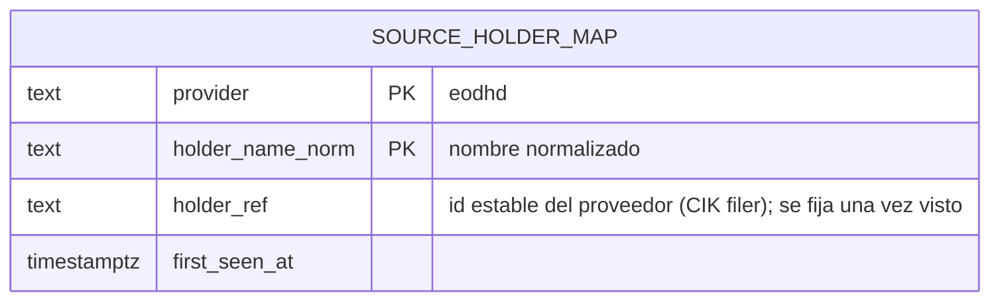

# Modelo de entidades — Resolución de identidad (normalizador)

Capa del normalizador. Mayormente **reglas** (ver `decisiones-modelo-identidad.md`); estructura nueva mínima. Reusa `SECURITY.isin`, `COMPANY.cik/lei`, `LISTING.provider_symbol` del núcleo.



## Cambios al núcleo (no tablas nuevas)

| Entidad | Cambio | Para qué |
|---|---|---|
| **COMPANY** | `+ identity_source` (`cik`\|`lei`\|`isolated`, CHECK) | Registra con qué evidencia se agrupó (Opción B). `isolated` → revisar. |
| **LISTING** | `UNIQUE (provider_symbol)` | Crosswalk del camino rápido (v1, un proveedor). |

## Tabla nueva

| Entidad | PK | Rol |
|---|---|---|
| **SOURCE_HOLDER_MAP** | `(provider, holder_name_norm)` | Memoria name→`holder_ref`. Cierra el anclado de `holder_ref` (ownership). |

## Algoritmo de resolución (pseudocódigo)

```
resolver(registro del proveedor):
  # camino rápido
  si existe LISTING con provider_symbol = registro.symbol:
      return ese listing_id

  # desde cero
  mic = resolver_mic(registro.symbol)            # datos de referencia
  security = buscar SECURITY por isin(registro)  # ancla primaria
  si no security:
      security = buscar por (mic, ticker)         # fallback
  si no security:
      company = resolver_company(registro)        # Opción B (CIK/LEI/isolated)
      security = crear SECURITY(isin, company)
  listing = buscar/crear LISTING(security, mic, ticker, provider_symbol)
  return listing_id

resolver_company(registro):
  si registro.cik y existe COMPANY por cik: return esa (identity_source=cik)
  si registro.lei y existe COMPANY por lei: return esa (identity_source=lei)
  si registro.cik: crear COMPANY(cik, identity_source=cik)
  si registro.lei: crear COMPANY(lei, identity_source=lei)
  si no: crear COMPANY(identity_source=isolated)  # marcar para revisión
```

## Reglas (no estructura)

- **Prioridad de matching:** ISIN → (MIC, ticker) → nuevo. Nunca por `provider_symbol`.
- **Anclado:** una vez `(provider, provider_symbol)` → listing, se recuerda; no se re-resuelve.
- **Cambio de ticker:** `symbol-change-history` → update `provider_symbol` + `LISTING_TICKER_CHANGE`, mismo `listing_id`.
- **Seguridad:** identificador nuevo que contradice un enlace existente → marcar para revisión, **nunca re-enlazar en silencio**.

## Instancias del mismo patrón (en sus chunks)

- ETF constituyente: ISIN→security (query). Noticias: ticker→security (query). Holder: `SOURCE_HOLDER_MAP`.

## Pendiente / verificar en vivo

- CIK/LEI a nivel de empresa en EODHD (sin eso, todo → `isolated`).
- `symbol-change-history` (cobertura; doc dice US only).
- Cobertura de ISIN (cuántos caen al fallback).
