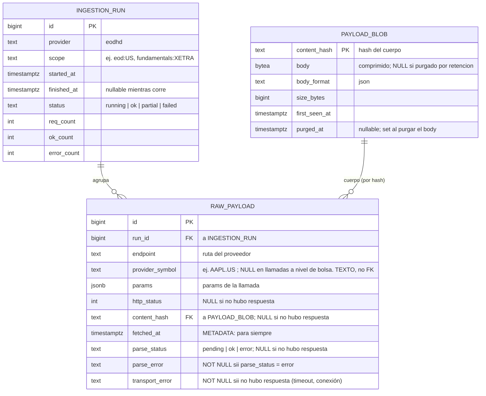

# Modelo de entidades — Ingesta / Normalizador (payload crudo)

Capa **anterior** a la fuente de verdad. Ninguna entidad aquí tiene FK a la fuente de verdad (ver `decisiones-modelo-ingesta.md` §3). Flujo: proveedor → crudo → (resolución) → fuente de verdad.

## Notas por entidad

| Entidad | PK | Rol | Retención |
|---|---|---|---|
| **INGESTION_RUN** | `id` | Agrupa las llamadas de una corrida. El materializador la consulta para saber que un mercado está completo (dispara al cierre). | Para siempre. |
| **RAW_PAYLOAD** | `id` | Una fila por llamada. Metadata de la petición + puntero al cuerpo por hash. Sin FK a la fuente de verdad. | Metadata para siempre. |
| **PAYLOAD_BLOB** | `content_hash` | Cuerpo crudo direccionado por contenido. Dedup: muchas RAW_PAYLOAD → un blob. | Body con retención configurable; fila (hash/size/purged_at) para siempre. |

## Principios aplicados

- **Desacople del flujo:** `RAW_PAYLOAD.provider_symbol` es texto, no FK — el `security_id` aún no existe cuando se inserta el crudo (§3).
- **Direccionado por contenido:** dedup y retención salen del `content_hash` (§4).
- **Metadata eterna / cuerpo purgable:** la separación RAW_PAYLOAD ↔ PAYLOAD_BLOB es la que permite "saber que la llamada existió para siempre, pero soltar el cuerpo tras N meses" (§5).
- **Idempotencia:** el hash hace idempotente la inserción del cuerpo; cada llamada deja su fila (§6).

## No es tabla (operación del pipeline)

- **Export a Excel/CSV:** volcado de `RAW_PAYLOAD` (+ body si vivo) para auditar/archivar antes de purgar.
- **Purga por retención:** `UPDATE PAYLOAD_BLOB SET body=NULL, purged_at=now() WHERE first_seen_at < umbral`.

## Pendiente / verificar en vivo

- Forma de `params`/`endpoint` por tipo de llamada de EODHD.
- ¿Guardar response headers (rate-limit, last-modified)? Decidir al construir la ingesta.
