# Modelo de entidades — Ownership / Analistas / Short Interest

Continúa `modelo-entidades.md` (núcleo). `NEWS`/`NEWS_SECURITY` viven en `modelo-noticias.md` (no son fuente de verdad de rigor financiero). Todas las entidades de este archivo cuelgan de `SECURITY` (núcleo).

```mermaid
erDiagram
  SECURITY ||--o{ HOLDER_POSITION : "held by"
  SECURITY ||--o{ INSIDER_TRANSACTION : "traded by insiders"
  SECURITY ||--o{ OWNERSHIP_SNAPSHOT : "aggregate as of"
  SECURITY ||--o{ ANALYST_CONSENSUS : "covered by"
  SECURITY ||--o{ SHORT_INTEREST : "reported for"

  HOLDER_POSITION {
    bigint id PK
    bigint security_id FK
    text holder_ref "id estable del proveedor; con EODHD esperado NULL (doc: sin id)"
    text holder_name "display; identidad = holder_name_norm(holder_name) si no hay ref"
    text holder_type "institution | fund (CHECK)"
    date as_of_date "eje snapshot-temporal, historico conservado"
    numeric shares_held
    numeric portfolio_weight_pct "nullable, no derivable por nosotros"
    timestamptz ingested_at "auditoria de pipeline, no eje temporal"
  }

  INSIDER_TRANSACTION {
    bigint id PK
    bigint security_id FK
    text provider_txn_id "id filing/txn del proveedor -> dedup preferida. NULL -> fallback. PROVISIONAL"
    text insider_name
    text relationship "PROVISIONAL, sin verificar"
    date transaction_date "hecho puntual, fecha propia"
    text transaction_code "codigo nativo del filing (P/S/A...)"
    numeric shares_transacted
    numeric price_per_share "nullable"
    numeric shares_owned_after "nullable"
    timestamptz ingested_at
  }

  OWNERSHIP_SNAPSHOT {
    bigint security_id PK "FK"
    date as_of_date PK "eje snapshot-temporal, historico conservado"
    numeric shares_float "nullable, no derivable"
    numeric percent_insiders "nullable, no derivable"
    numeric percent_institutions "nullable, no derivable"
  }

  ANALYST_CONSENSUS {
    bigint security_id PK "FK"
    date as_of_date PK "eje snapshot-temporal, historico conservado"
    numeric rating_mean "tal cual del proveedor; verificado con AAPL: 5=Strong Buy"
    int strong_buy "nullable, recuento"
    int buy "nullable"
    int hold "nullable"
    int sell "nullable"
    int strong_sell "nullable"
    int num_analysts "nullable: solo si el proveedor lo da explicito"
    numeric target_mean
    numeric target_low
    numeric target_high
    text target_currency "explicito, no asumir quote_currency"
  }

  SHORT_INTEREST {
    bigint security_id PK "FK"
    date as_of_date PK "dia de observacion (eje snapshot-temporal)"
    date settlement_date "nullable: solo si el proveedor la da"
    numeric shares_short "primitivo: de aqui cuelgan los derivados"
    numeric shares_short_prior_month "nullable, SOLO fallback de arranque (no primitivo, ver decisiones 5.b)"
  }
```

## Notas por entidad

| Entidad | Cuelga de | PK / UNIQUE | Patrón temporal |
|---|---|---|---|
| **HOLDER_POSITION** | SECURITY | `id` PK + `UNIQUE (security_id, COALESCE(holder_ref, holder_name_norm(holder_name)), as_of_date)` | Snapshot-temporal — histórico conservado. |
| **INSIDER_TRANSACTION** | SECURITY | `id` PK + dedup preferido por `provider_txn_id`; fallback `UNIQUE (security_id, insider_name, transaction_date, transaction_code, shares_transacted)` | Hecho-puntual — `ingested_at` simple. |
| **OWNERSHIP_SNAPSHOT** | SECURITY | natural `(security_id, as_of_date)` | Snapshot-temporal — histórico conservado. |
| **ANALYST_CONSENSUS** | SECURITY | natural `(security_id, as_of_date)` | Snapshot-temporal — histórico conservado. |
| **SHORT_INTEREST** | SECURITY | natural `(security_id, as_of_date)`; `settlement_date` nullable; deduplicación por valor | Snapshot-temporal — histórico conservado. |

**Regla de PK:** natural cuando la clave es `(security_id, <fecha>)` limpia; `id` sintético + `UNIQUE` solo cuando la clave natural incluye un string libre (`HOLDER_POSITION`) o no hay clave natural fiable (`INSIDER_TRANSACTION`). Sin el `UNIQUE`, una re-ingesta de la misma fecha duplica filas en estas tablas append-only (mismo riesgo que `is_primary_listing` en el núcleo).

**Tres patrones temporales** (marco general, aplica a todo el modelo, no solo a este chunk):

| Patrón | Pregunta que responde | Entidades |
|---|---|---|
| Bitemporal | ¿Se restatea un hecho ya publicado? | `FUNDAMENTALS`, `SHARES_OUTSTANDING` (núcleo) |
| Snapshot-temporal | ¿Cambia en el tiempo sin restatearse, y la serie es señal? | `HOLDER_POSITION`, `OWNERSHIP_SNAPSHOT`, `ANALYST_CONSENSUS`, `SHORT_INTEREST` |
| Hecho-puntual | ¿Ocurre una vez, con fecha propia, sin repetirse? | `INSIDER_TRANSACTION`, `DIVIDEND`, `STOCK_SPLIT` (núcleo) |

## Identidad del holder (riesgo nombrado)

`holder_name` no es estable entre snapshots ("BlackRock Inc" vs "BlackRock, Inc."). `holder_ref` (id estable del proveedor, ej. CIK del filer) es la clave preferida; `holder_name` es fallback de identidad y display. **Regla de ingesta** (no de schema): una vez visto un `holder_ref` para un holder, fijarlo — no volver a `holder_name` aunque el proveedor lo omita en una ingesta puntual, o la serie se parte igual que con nombre puro.

## Derivados de este chunk (NO en la fuente de verdad)

- **`short_ratio`** = `SHORT_INTEREST.shares_short` ÷ volumen medio diario (`PRICES_DAILY`).
- **`short_percent_float`** = `SHORT_INTEREST.shares_short` ÷ `OWNERSHIP_SNAPSHOT.shares_float` (fila con `as_of_date` más reciente ≤ `settlement_date`).
- **`shares_short_prior_month` (lectura)** = fila de `SHORT_INTEREST` con `settlement_date` inmediatamente anterior en la serie; la columna homónima solo se usa como fallback de arranque cuando aún no hay fila previa.
- **Variación de posición de un holder** = comparar filas consecutivas de `HOLDER_POSITION` por `(security_id, holder_ref)` — o por `holder_name` cuando `holder_ref` es NULL (frágil).
- **`transaction_value`** (insider) = `shares_transacted` × `price_per_share`.

## Pendiente / verificar en vivo

1. `holder_ref` (id estable de filer): existencia en EODHD sin verificar.
2. `provider_txn_id`: existencia en EODHD sin verificar; define si el dedup es por id o por clave compuesta fallback.
3. ~~Dirección de escala `rating_mean`~~ ✅ 5 = Strong Buy, verificado con el payload real de AAPL (2026-10-12).
4. `holder_type` como `CHECK` inline (decidido: se queda; subir a tabla solo si crece).
