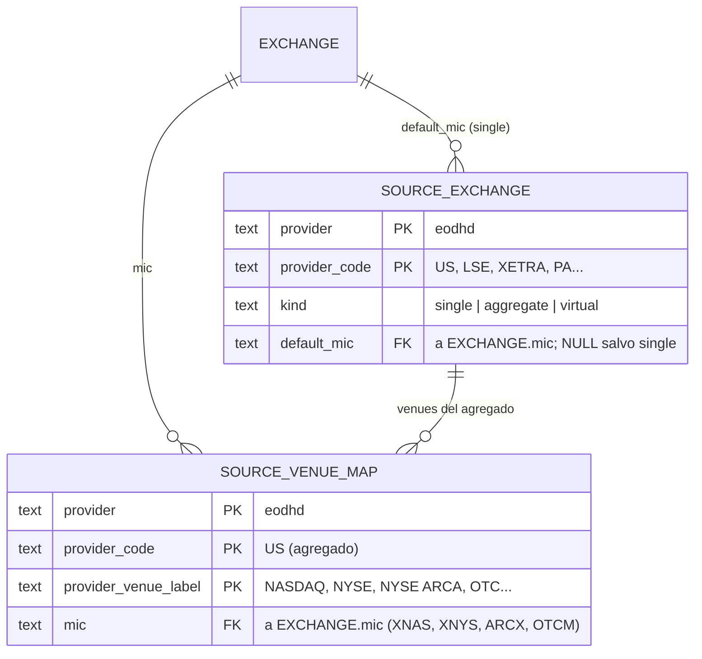

# Modelo de entidades — Datos de referencia (código-proveedor ↔ MIC)

Capa del normalizador. Mapea cómo nombra el proveedor las bolsas a la bolsa real (`EXCHANGE`, por MIC). Ver `decisiones-modelo-referencia.md`.

## Notas por entidad

| Entidad | PK | Rol |
|---|---|---|
| **SOURCE_EXCHANGE** | `(provider, provider_code)` | Catálogo de códigos del proveedor. `kind` decide cómo se resuelve; `default_mic` solo para `single`. |
| **SOURCE_VENUE_MAP** | `(provider, provider_code, provider_venue_label)` | Sub-bolsa dentro de un agregado → MIC. Solo filas para códigos `aggregate`. |

**Relación con EXCHANGE:** ambas apuntan a `EXCHANGE.mic` (la bolsa real). No al revés: `EXCHANGE` no sabe cómo la nombra ningún proveedor.

## Resolución (normalizador)

`provider_symbol` (`AAPL.US`) → código `US` → `SOURCE_EXCHANGE`:
- `single` → `default_mic`.
- `aggregate` → venue del símbolo + `SOURCE_VENUE_MAP` → MIC.
- `virtual` → saltar.
→ MIC → `EXCHANGE.exchange_id` para el `LISTING`.

Venue desconocido en un agregado → marcar el símbolo para revisión, no inventar MIC.

## Cambio al núcleo

`EXCHANGE` gana `timezone` (IANA) y `close_time` (hora local), para el disparo de materialización por cierre de mercado. Ver `modelo-entidades.md`.

## Pendiente / verificar en vivo

- Campo de sub-bolsa por símbolo en `exchange-symbol-list` (para `SOURCE_VENUE_MAP`).
- Seed de `SOURCE_EXCHANGE` desde `exchanges-list` (code + OperatingMIC).
- Timezones y horarios de cierre por MIC (fuente estándar).
