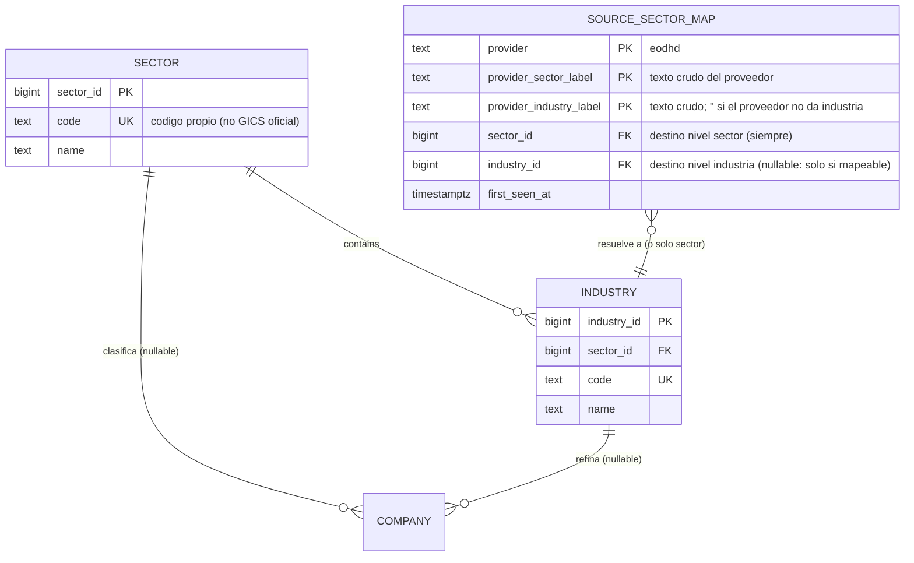

# Modelo de entidades — Taxonomía sectorial

Clasificación canónica propia (dos niveles) + mapeo desde el proveedor. Ver decisiones en `decisiones-modelo-taxonomia.md`. Sustituye el texto libre `COMPANY.sector`/`industry`.

## Cambios al núcleo (`COMPANY`)

| Cambio | Detalle |
|---|---|
| **Elimina** `sector`, `industry` (texto libre) | Sustituidos por FK canónicas. |
| **+ `sector_id`** FK → `SECTOR` (nullable) | Clasificación a nivel sector. NULL = no clasificado (fuera del ranking). |
| **+ `industry_id`** FK → `INDUSTRY` (nullable) | Refinamiento. Independiente de `sector_id` (conocimiento parcial permitido). |
| **Trigger de consistencia** | Si ambos puestos → exige `COMPANY.sector_id = INDUSTRY.sector_id`. CHECK no sirve (cross-tabla). |

## Tablas nuevas

| Entidad | PK | Rol | Capa |
|---|---|---|---|
| **SECTOR** | `sector_id` | Nivel 1. ~11 cubos propios (GICS como referencia conceptual, no copia). | Referencia (núcleo) |
| **INDUSTRY** | `industry_id` | Nivel 2. Cuelga de SECTOR. Separa Banking/Insurance, aísla REITs. | Referencia (núcleo) |
| **SOURCE_SECTOR_MAP** | `(provider, provider_sector_label, provider_industry_label)` | Memoria texto-proveedor → ids canónicos. Resuelve a industria (sector incluido) o solo sector. | Normalizador |

## Reglas

- **Resolución:** `(provider_sector_label, provider_industry_label)` → `industry_id` si mapeable (sector viene con él); si no, → solo `sector_id`; si nada → **marcar para revisión**, company queda con ambos NULL.
- **Doble consumidor:** `SOURCE_SECTOR_MAP` resuelve tanto `COMPANY` (sector/industria) como `ETF_ALLOCATION.bucket` (cuando `dimension='sector'`) → `SECTOR`. Vocabulario sectorial único para acciones y ETFs.
- **Peer group** `sector × región` se arma en VISTAS: sector de aquí, región derivada de `COMPANY.country_iso` (US/Canadá/Europa). La taxonomía es neutral a región.
- **Auditoría:** `SECTOR`, `INDUSTRY`, `SOURCE_SECTOR_MAP` entran en `DIMENSION_AUDIT` (dimensiones mutables). Reclasificar una company ya queda auditado (`COMPANY` lo está).

## Pendiente / verificar en vivo

- Clasificación de EODHD por región → trabajo inicial de poblar `SOURCE_SECTOR_MAP`.
- Set inicial de `SECTOR`/`INDUSTRY` propios.
- Corte de regiones sobre `country_iso` (se decide al diseñar VISTAS).
