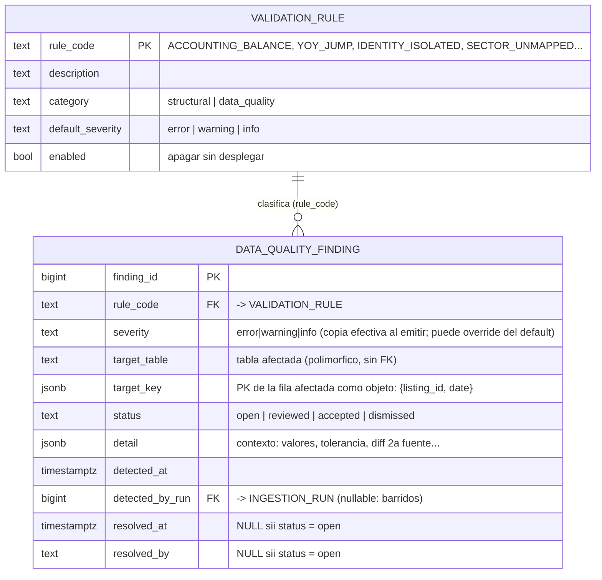

# Modelo de entidades — Capa de validación

Sumidero único de hallazgos + catálogo de reglas. Ver decisiones en `decisiones-modelo-validacion.md`. No bloquea la ingesta; VISTAS filtra por severidad.

> **Polimórfica a propósito.** `target_table` + `target_key` apuntan a cualquier fila de cualquier tabla, sin FK. Segunda excepción consciente al anti-patrón polimórfico (como `DIMENSION_AUDIT`): infra transversal, sin referencias entrantes, heterogénea por diseño.

## Tablas nuevas

| Entidad | PK | Rol |
|---|---|---|
| **VALIDATION_RULE** | `rule_code` | Catálogo (comportamiento como dato): `enabled`, `default_severity`, `category`. Lógica en código. |
| **DATA_QUALITY_FINDING** | `finding_id` | Sumidero único de todo lo que requiere revisión humana (calidad + estructural). |

## Productores que alimentan el sumidero (todos con su `rule_code`)

| rule_code | category | Severidad típica | Origen |
|---|---|---|---|
| `ACCOUNTING_BALANCE` | data_quality | error | Validador (Activo = Pasivo + Patrimonio ± tol.) |
| `CURRENCY_COHERENCE` | data_quality | error | Validador (precio↔fundamentales) |
| `YOY_JUMP` | data_quality | warning | Validador (salto >200% revenue/shares) |
| `SECOND_SOURCE_MISMATCH` | data_quality | warning/error | Regla 2ª fuente (SEC) no cuadra |
| `STALENESS` | data_quality | warning | Umbral de antigüedad superado |
| `IDENTITY_ISOLATED` | structural | warning | Identidad (company sin CIK/LEI) |
| `IDENTITY_RELINK_CONFLICT` | structural | error | Identidad (id contradice enlace) |
| `HOLDER_UNMAPPED` | structural | warning | Ownership (holder sin `holder_ref`) |
| `SECTOR_UNMAPPED` | structural | warning | Taxonomía (label proveedor sin mapeo; aplica a `COMPANY` y a `ETF_ALLOCATION.bucket`) |
| `CORPORATE_EVENT_CHANGED` | data_quality | warning | Normalizador: un dividendo o split ya guardado llega con otro valor; se actualiza y el finding guarda anterior y nuevo (`decisiones-modelo.md` §5.5) |
| `DIVIDEND_SAME_EX_DATE` | structural | warning | Normalizador: una respuesta trae dos o más dividendos con la misma fecha ex para un valor; esa fecha no se escribe hasta revisarla (`decisiones-modelo.md` §5.5) |

## Consumo por VISTAS (cortafuegos)

- **Excluir** del scoring y del usuario: filas con finding `severity='error' AND status='open'`.
- **Badge** de revisión en UI: filas con finding `warning` abierto.
- `cross_checked`: lo puebla la regla de 2ª fuente al cuadrar (no es un finding; es la transición de `reported_at_source`).

## Convenciones de `target`

- `target_key` es la PK de la fila afectada como objeto JSON, construida en SQL desde la propia fila (`jsonb_build_object('listing_id', p.listing_id, 'date', p.date)`), nunca escrita a mano en TypeScript: así el formato de fechas y números es siempre el de Postgres.
- Un finding sobre un dato **ausente o viejo** (`STALENESS`) no tiene fila natural: apunta con `target_table='security'`, `target_key={"security_id": n}`. Convención, no estructura nueva.
- Un finding sobre una fila **que no se llegó a crear** (`DIVIDEND_SAME_EX_DATE`) apunta al crudo que la trajo: `target_table='raw_payload'`, `target_key={"raw_payload_id": n}`.
- Unicidad, estados y re-emisión: `decisiones-modelo-validacion.md` §6.

## Pendiente / verificar

- Catálogo inicial de `rule_code` + severidades por defecto.
- Tolerancias (cuadre, margen 2ª fuente, % salto, staleness).
- `finding_type` denormalizado vs join a `category` (decisión de rendimiento del panel).
