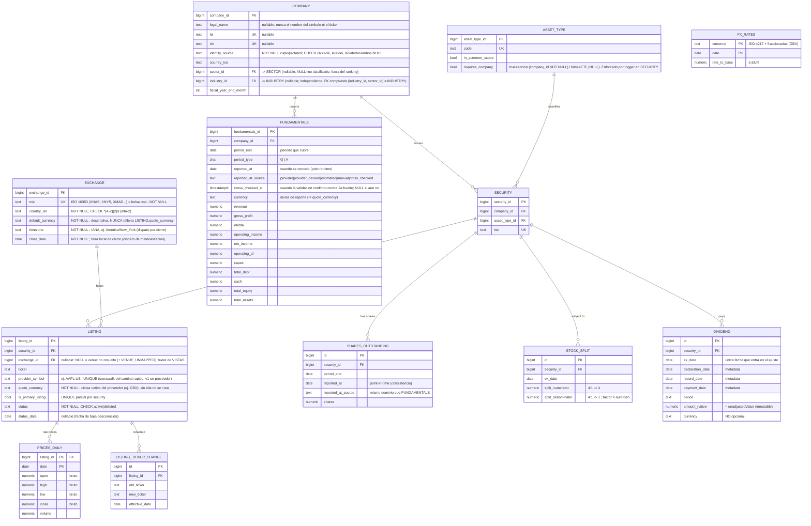

# Modelo de entidades — Fuente de verdad (núcleo)

Diagrama de la **fuente de verdad** (no incluye la capa de lectura / snapshot, que se diseña aparte).

> **Núcleo.** Entidades base: identidad (COMPANY/SECURITY/LISTING), fundamentales, precios, eventos corporativos, FX. Otros dominios ya cerrados viven en archivos propios bajo los mismos principios: `modelo-entidades-ownership.md` (analistas/ownership/short interest), `modelo-entidades-etf.md` (ETFs), `modelo-noticias.md` (noticias, subsistema aparte). Índice en `README.md`. Pendiente: earnings (eventos corporativos), payload crudo, log de correcciones, capa de lectura.

Convenciones:
- Todo se guarda en **forma nativa e inmutable**. La inmutabilidad aplica a los **valores** financieros (un restatement es una fila nueva por `reported_at`); los **flags de procedencia** (`reported_at_source`, `cross_checked_at`) sí transicionan de estado sobre la fila (`provider → cross_checked`), lo cual es una anotación de validación, no un cambio de dato. Esa transición en tablas de hechos **no** la audita `DIMENSION_AUDIT` (solo dimensiones); su traza temporal la da `cross_checked_at`.
- Lo derivable (EPS, P/E, capitalización, precio ajustado) **no aparece aquí**: se calcula en la capa de lectura.

## Notas por entidad

| Entidad | Cuelga de | Rol |
|---|---|---|
| **COMPANY** | — | Negocio. `sector_id`/`industry_id` (FK a taxonomía canónica, ver `modelo-entidades-taxonomia.md`), fiscal year end. |
| **SECURITY** | COMPANY | Clase de acción (ISIN). |
| **LISTING** | SECURITY + EXCHANGE | Cotización (ticker, divisa, primario). |
| **FUNDAMENTALS** | COMPANY | Estados financieros absolutos, por periodo (Q/A). |
| **SHARES_OUTSTANDING** | SECURITY | Acciones por periodo (para per-share correcto). |
| **STOCK_SPLIT** | SECURITY | Splits (`split_numerator`/`split_denominator` nativos). Base del ajuste. |
| **DIVIDEND** | SECURITY | Dividendos (`amount_native` = unadjustedValue). Base del total-return. |
| **PRICES_DAILY** | LISTING | Solo OHLCV **bruto**, divisa nativa. Inmutable. |
| **EXCHANGE** | — | Bolsa real, clave = MIC. No el código de proveedor. `timezone`+`close_time` para el disparo de materialización por cierre (ver chunk de referencia). El mapa código-proveedor↔MIC vive en la capa del normalizador, no aquí. **Dato curado: todas sus columnas NOT NULL; solo se crea desde el seed, nunca desde el normalizador** (`decisiones-modelo-referencia.md` §5). |
| **ASSET_TYPE** | — | Catálogo de tipos. `in_screener_scope` filtra el screener; `requires_company` gobierna si `SECURITY.company_id` debe ser NOT NULL (enforcado por trigger, ver `decisiones-modelo-etf.md` §1). |
| **LISTING_TICKER_CHANGE** | LISTING | Historial de tickers (SEO / no confundir con deslistado). Prescindible en MVP. |
| **FX_RATES** | — | Tipos de cambio a EUR. GBX como fila propia. Forward-fill. |

## Derivados (NO en la fuente de verdad — se calculan en la capa de lectura)

- **EPS** = net_income(COMPANY, TTM) ÷ shares(SECURITY)
- **Capitalización** = close(LISTING primario) × shares(SECURITY) × fx→EUR
- **P/E** = close ÷ EPS *(reconciliar divisa: close en quote_currency, EPS en FUNDAMENTALS.currency)*
- **P/B, P/S, ROE, ROA, márgenes, deuda/equity** = cruces de líneas de FUNDAMENTALS y/o precio *(reconciliar divisa antes de cruzar fundamentales con precio)*
- **Precio ajustado (splits / total return)** = PRICES_DAILY (bruto) × factor(STOCK_SPLIT) [y DIVIDEND para TR]
- **Dividendo ajustado** = DIVIDEND.amount_native × misma cadena de factores de split (invariante 5.4)
- **RSI, SMA, MACD, 52w, volumen medio** = sobre la serie ajustada por splits
