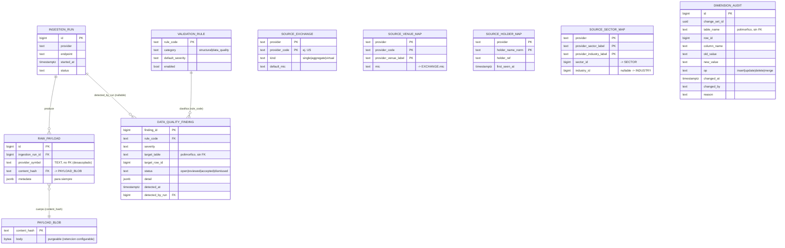

# Base de datos — mapa general centralizado

Vista única de todo el modelo montado hasta ahora. Centraliza las entidades dispersas en los archivos de chunk (`modelo-entidades*.md`), más dos entidades de **frontera** que no son tablas sino los extremos del flujo:

- **EODHD** (arriba) — el proveedor externo. De aquí entra *todo*. No es una tabla; es el origen.
- **VISTAS** (abajo) — la capa de lectura ya materializada (`screener_snapshot` y derivados). No es fuente de verdad; es la proyección que consulta el screener. **Aún sin diseñar en detalle** (única pieza pendiente).

Entre medias hay **cuatro capas reales**: normalizador (ingesta), fuente de verdad, auditoría y validación (ambas transversales sobre la fuente de verdad).

> Este archivo es un índice visual, no sustituye a los chunks. Cada bloque remite a su archivo de detalle. Si un dato contradice a un chunk, manda el chunk.

---

## Flujo de datos (de proveedor a pantalla)

```
   ┌─────────────────────────────────────────────────────────────┐
   │                        EODHD (proveedor)                      │
   │   EOD · Fundamentals · Splits/Divs · Earnings · Ownership ·   │
   │   Analysts · Short · ETF_Data · News · Exchanges/Symbols      │
   └─────────────────────────────┬───────────────────────────────┘
                                 │
                                 ▼
   ┌─────────────────────────────────────────────────────────────┐
   │                 NORMALIZADOR (capa de ingesta)                │
   │   Captura cruda + resolución de identidad. Desacoplado de la  │
   │   fuente de verdad.                                           │
   │     Payload:    INGESTION_RUN · RAW_PAYLOAD · PAYLOAD_BLOB    │
   │     Referencia: SOURCE_EXCHANGE · SOURCE_VENUE_MAP           │
   │     Identidad:  SOURCE_HOLDER_MAP (+ crosswalk en LISTING)   │
   │     Taxonomía:  SOURCE_SECTOR_MAP                            │
   └─────────────────────────────┬───────────────────────────────┘
                                 │  resolución (ISIN→security, símbolo→listing,
                                 │  CIK/LEI→company, label→sector)
                                 ▼
   ┌─────────────────────────────────────────────────────────────┐
   │                  FUENTE DE VERDAD (Postgres)                  │
   │   Inmutable, forma/divisa nativa. No conoce la capa de vista. │
   │                                                               │
   │   Identidad:  COMPANY · SECURITY · LISTING · EXCHANGE ·        │
   │               ASSET_TYPE · LISTING_TICKER_CHANGE              │
   │   Taxonomía:  SECTOR · INDUSTRY                              │
   │   Financiero: FUNDAMENTALS · SHARES_OUTSTANDING             │
   │   Precios:    PRICES_DAILY (bruto) · FX_RATES               │
   │   Eventos:    STOCK_SPLIT · DIVIDEND · EARNINGS             │
   │   Ownership:  HOLDER_POSITION · INSIDER_TRANSACTION ·        │
   │               OWNERSHIP_SNAPSHOT · ANALYST_CONSENSUS ·       │
   │               SHORT_INTEREST                                │
   │   ETF:        ETF_PROFILE · ETF_NAV_DAILY · ETF_HOLDING ·    │
   │               ETF_ALLOCATION                                │
   └───────┬─────────────────────────────────────────────┬───────┘
           │ (transversal)                                │
           ▼                                              │
   ┌───────────────────────────┐                          │ materializador
   │  AUDITORÍA + VALIDACIÓN    │                          │ (cruza niveles, deriva,
   │  DIMENSION_AUDIT (cambios  │                          │  reconcilia divisa,
   │   en dimensiones)          │                          │  aplica factores split)
   │  VALIDATION_RULE +         │                          │
   │  DATA_QUALITY_FINDING      │◄── cortafuegos ──────────┤
   │  (sumidero de revisión)    │                          │
   └───────────────────────────┘                          ▼
                                  ┌─────────────────────────────────────────────┐
                                  │             VISTAS (capa de lectura)         │
                                  │  Proyección congelada, filtrar/ordenar.      │
                                  │  screener_snapshot (1 fila/listing primario) │
                                  │  + series ajustadas. RECONSTRUIBLE AL 100%.  │
                                  │  [PENDIENTE DE DISEÑAR]                      │
                                  └─────────────────────────────────────────────┘

   Aparte (no fuente de verdad):  NEWS · NEWS_SECURITY  (feed de contenido)
```

VISTAS filtra con `DATA_QUALITY_FINDING` (excluye `error+open`, marca `warning` con badge) y lee `reported_at_source` (`provider`→`cross_checked` lo transiciona la validación).

---

## Diagrama ER — Fuente de verdad + fronteras

```mermaid
erDiagram
  EODHD ||--o{ COMPANY : "ingesta (via normalizador)"
  EODHD ||--o{ SECURITY : "ingesta"
  EODHD ||--o{ PRICES_DAILY : "ingesta"

  SECTOR ||--o{ INDUSTRY : contains
  SECTOR ||--o{ COMPANY : "clasifica (nullable)"
  INDUSTRY ||--o{ COMPANY : "refina (nullable)"

  COMPANY ||--o{ SECURITY : issues
  COMPANY ||--o{ FUNDAMENTALS : reports
  ASSET_TYPE ||--o{ SECURITY : classifies
  SECURITY ||--o{ LISTING : "quoted as"
  SECURITY ||--o{ SHARES_OUTSTANDING : "has shares"
  SECURITY ||--o{ STOCK_SPLIT : "subject to"
  SECURITY ||--o{ DIVIDEND : pays
  SECURITY ||--o{ EARNINGS : "reports on"
  EXCHANGE ||--o{ LISTING : hosts
  LISTING ||--o{ PRICES_DAILY : "raw prices"
  LISTING ||--o{ LISTING_TICKER_CHANGE : renamed

  SECURITY ||--o{ HOLDER_POSITION : "held by"
  SECURITY ||--o{ INSIDER_TRANSACTION : "insider trades"
  SECURITY ||--o{ OWNERSHIP_SNAPSHOT : "ownership as of"
  SECURITY ||--o{ ANALYST_CONSENSUS : "covered by"
  SECURITY ||--o{ SHORT_INTEREST : "short as of"

  SECURITY ||--o| ETF_PROFILE : "is an ETF"
  SECURITY ||--o{ ETF_NAV_DAILY : "nav series"
  SECURITY ||--o{ ETF_HOLDING : holds
  SECURITY ||--o{ ETF_ALLOCATION : "exposure as of"
  SECTOR |o--o{ ETF_ALLOCATION : "sector canonico (dimension=sector)"
  SECURITY |o--o{ ETF_HOLDING : "is constituent of"

  FUNDAMENTALS ||--o{ VISTAS : materializa
  PRICES_DAILY ||--o{ VISTAS : materializa
  SECURITY ||--o{ VISTAS : materializa

  EODHD {
    text _ "PROVEEDOR externo (no es tabla). Origen de todo."
    text endpoints "EOD, Fundamentals, Div, Splits, Earnings, Ownership, ETF_Data, News, Exchanges"
    text identidad "simbolo SYMBOL.EXCHANGE (codigo EODHD, no MIC)"
  }

  SECTOR {
    bigint sector_id PK
    text code UK "propio (no GICS oficial)"
    text name
  }

  INDUSTRY {
    bigint industry_id PK
    bigint sector_id FK
    text code UK
    text name
  }

  COMPANY {
    bigint company_id PK
    text legal_name
    text lei UK "nullable"
    text cik UK "nullable"
    text identity_source "cik|lei|isolated"
    text country_iso
    bigint sector_id FK "nullable (NULL=no clasificado, fuera del ranking)"
    bigint industry_id FK "nullable (trigger de consistencia con sector_id)"
    int fiscal_year_end_month
  }

  SECURITY {
    bigint security_id PK
    bigint company_id FK "nullable: NULL=ETF, NOT NULL=accion (trigger vs ASSET_TYPE.requires_company)"
    bigint asset_type_id FK
    text isin UK
  }

  LISTING {
    bigint listing_id PK
    bigint security_id FK
    bigint exchange_id FK "resuelto del sub-exchange del simbolo"
    text ticker
    text provider_symbol "ej. AAPL.US ; UNIQUE (crosswalk v1)"
    text quote_currency "nativa (ej. GBX)"
    bool is_primary_listing "UNIQUE parcial por security"
    text status
    date status_date
  }

  EXCHANGE {
    bigint exchange_id PK
    text mic UK "ISO 10383 = bolsa real, no codigo proveedor"
    text country_iso "NOT NULL, alfa-2"
    text default_currency "NOT NULL, descriptiva"
    text timezone "NOT NULL, IANA (disparo por cierre)"
    time close_time "NOT NULL, hora local de cierre"
  }

  ASSET_TYPE {
    bigint asset_type_id PK
    text code UK
    bool in_screener_scope
    bool requires_company "gobierna company_id NULL (trigger)"
  }

  FUNDAMENTALS {
    bigint fundamentals_id PK
    bigint company_id FK
    date period_end
    char period_type "Q | A"
    date reported_at "point-in-time (bitemporal)"
    text reported_at_source "provider|provider_derived|estimated|manual|cross_checked"
    timestamptz cross_checked_at "sellado al confirmar 2a fuente; NULL si no"
    text currency "divisa de reporte"
    numeric revenue
    numeric net_income
    numeric ebitda
    numeric total_debt
    numeric total_equity
    numeric _otros "gross_profit, op_income, op_cf, capex, cash, total_assets"
  }

  SHARES_OUTSTANDING {
    bigint id PK
    bigint security_id FK
    date period_end
    date reported_at "point-in-time"
    text reported_at_source
    bigint shares
  }

  STOCK_SPLIT {
    bigint id PK
    bigint security_id FK
    date ex_date
    numeric split_numerator "4:1 -> 4"
    numeric split_denominator "4:1 -> 1 ; factor = num/den"
  }

  DIVIDEND {
    bigint id PK
    bigint security_id FK
    date ex_date "unica fecha que ajusta"
    date declaration_date "metadata"
    date record_date "metadata"
    date payment_date "metadata"
    text period
    numeric amount_native "= unadjustedValue"
    text currency "NO opcional"
  }

  EARNINGS {
    bigint security_id PK "FK"
    date fiscal_period_end PK "casa con FUNDAMENTALS"
    char period_type PK "Q | A"
    date report_date "estimada si futuro, real si ocurrido"
    text report_time "before_market|after_market|unknown (CHECK)"
    numeric eps_estimate "nullable"
    numeric revenue_estimate "nullable"
    text estimate_currency "explicito"
    bool is_reported "false=futuro, true=consolidado"
  }

  PRICES_DAILY {
    bigint listing_id PK "FK"
    date date PK
    numeric open "bruto"
    numeric high "bruto"
    numeric low "bruto"
    numeric close "bruto"
    bigint volume
  }

  FX_RATES {
    text currency PK "ISO-4217 + fraccionarias (GBX)"
    date date PK
    numeric rate_to_base "a EUR"
  }

  LISTING_TICKER_CHANGE {
    bigint id PK
    bigint listing_id FK
    text old_ticker
    text new_ticker
    date effective_date
  }

  HOLDER_POSITION {
    bigint id PK
    bigint security_id FK
    text holder_ref "id estable proveedor, NULL->fallback name"
    text holder_name "display + fallback"
    text holder_type "institution|fund (CHECK)"
    date as_of_date "snapshot-temporal"
    bigint shares_held
    numeric portfolio_weight_pct "nullable"
    timestamptz ingested_at
  }

  INSIDER_TRANSACTION {
    bigint id PK
    bigint security_id FK
    text provider_txn_id "dedup preferida, NULL->fallback. PROVISIONAL"
    text insider_name
    text relationship "PROVISIONAL"
    date transaction_date "hecho puntual"
    text transaction_code "P/S/A..."
    numeric shares_transacted
    numeric price_per_share "nullable"
    numeric shares_owned_after "nullable"
    timestamptz ingested_at
  }

  OWNERSHIP_SNAPSHOT {
    bigint security_id PK "FK"
    date as_of_date PK "snapshot-temporal"
    bigint shares_float "nullable, no derivable"
    numeric percent_insiders "nullable"
    numeric percent_institutions "nullable"
  }

  ANALYST_CONSENSUS {
    bigint security_id PK "FK"
    date as_of_date PK "snapshot-temporal"
    numeric rating_mean "1=Strong Buy..5=Strong Sell. VERIFICAR"
    int num_analysts
    numeric target_mean
    numeric target_low
    numeric target_high
    text target_currency "explicito"
  }

  SHORT_INTEREST {
    bigint security_id PK "FK"
    date settlement_date PK "snapshot-temporal"
    bigint shares_short "primitivo"
    bigint shares_short_prior_month "nullable, solo fallback arranque"
  }

  ETF_PROFILE {
    bigint security_id PK "FK 1:1"
    text issuer "gestora (gancho a Opcion C)"
    date inception_date
    text index_tracked
    text category
    text domicile
    numeric expense_ratio "historial via DIMENSION_AUDIT"
  }

  ETF_NAV_DAILY {
    bigint security_id PK "FK"
    date date PK
    numeric nav
    text nav_currency "explicito"
    numeric aum
    bigint shares_outstanding_etf "creation/redemption"
  }

  ETF_HOLDING {
    bigint id PK
    bigint security_id FK "el ETF"
    date as_of_date "snapshot-temporal"
    bigint constituent_security_id FK "a SECURITY si esta; NULL->fallback"
    text constituent_isin "fallback"
    text constituent_name "fallback/display"
    numeric weight_pct "NOT NULL: define el holding"
    numeric market_value "nullable"
    bigint shares_held "nullable"
  }

  ETF_ALLOCATION {
    bigint id PK
    bigint security_id FK
    date as_of_date "snapshot-temporal"
    text dimension "sector|country|asset_type"
    text bucket "texto proveedor (display/fallback)"
    bigint sector_id FK "nullable: -> SECTOR canonico si dimension='sector' (via SOURCE_SECTOR_MAP)"
    numeric weight_pct
    text source "provider (canonico) | derived"
  }

  VISTAS {
    text _ "CAPA DE LECTURA materializada (no es fuente de verdad). PENDIENTE."
    text screener_snapshot "1 fila por listing primario; ratios/tecnicos/cap congelados"
    text series_ajustadas "precio split-adj y total-return materializados"
    text propiedad "reconstruible 100% desde la fuente de verdad"
  }
```



---

## Diagrama ER — Normalizador + capas transversales

Tablas que **no** son fuente de verdad: capturan lo crudo, mapean identidad, auditan y validan. Detalle en sus chunks (`*-ingesta`, `*-referencia`, `*-identidad`, `*-auditoria`, `*-validacion`).



> `DIMENSION_AUDIT` y `DATA_QUALITY_FINDING` son **polimórficas a propósito** (sin FK entrantes): las dos excepciones conscientes al anti-patrón, justificadas por ser infraestructura transversal. `DATA_QUALITY_FINDING` es el **sumidero único** de los cinco productores de "marcar para revisión".

---

## Inventario de entidades (36 tablas + 2 fronteras)

### Frontera superior
| "Entidad" | Qué es | Archivo |
|---|---|---|
| **EODHD** | Proveedor externo. Origen de todo vía normalizador. No es tabla. | `decisiones-modelo.md` §7 |

### Normalizador — capa de ingesta (7)
| Entidad | PK | Rol | Chunk |
|---|---|---|---|
| **INGESTION_RUN** | `id` | Metadata de cada corrida de ingesta. | ingesta |
| **RAW_PAYLOAD** | `id` | Un payload crudo por símbolo/corrida. `provider_symbol` TEXT (desacoplado). | ingesta |
| **PAYLOAD_BLOB** | `content_hash` | Cuerpo direccionado por contenido. Purgable. | ingesta |
| **SOURCE_EXCHANGE** | `(provider, provider_code)` | Código-proveedor (`US`) → tipo + MIC por defecto. | referencia |
| **SOURCE_VENUE_MAP** | `(provider, provider_code, provider_venue_label)` | Resolución fina del agregado → MIC. | referencia |
| **SOURCE_HOLDER_MAP** | `(provider, holder_name_norm)` | Memoria nombre→`holder_ref`. | identidad |
| **SOURCE_SECTOR_MAP** | `(provider, sector_label, industry_label)` | Texto proveedor → `sector_id`/`industry_id`. | taxonomía |

### Fuente de verdad — Identidad + Taxonomía (8)
| Entidad | PK | Rol | Chunk |
|---|---|---|---|
| **COMPANY** | `company_id` | Negocio. `sector_id`/`industry_id` FK, `identity_source`. | núcleo + identidad + taxonomía |
| **SECURITY** | `security_id` | Clase de acción (ISIN). `company_id` nullable (ETF). | núcleo |
| **LISTING** | `listing_id` | Cotización (bolsa+ticker+divisa). `provider_symbol` UNIQUE. | núcleo |
| **EXCHANGE** | `exchange_id` | Bolsa real (MIC) + `timezone`/`close_time`. | núcleo + referencia |
| **ASSET_TYPE** | `asset_type_id` | Catálogo de tipos. Comportamiento-como-dato. | núcleo |
| **LISTING_TICKER_CHANGE** | `id` | Historial de tickers. Prescindible MVP. | núcleo |
| **SECTOR** | `sector_id` | Nivel 1 taxonomía (canónica propia). | taxonomía |
| **INDUSTRY** | `industry_id` | Nivel 2 taxonomía (cuelga de SECTOR). | taxonomía |

### Fuente de verdad — Financiero / Precios / Eventos (7)
| Entidad | PK | Patrón temporal | Chunk |
|---|---|---|---|
| **FUNDAMENTALS** | `id` + UNIQUE(company,period,type,reported_at) | Bitemporal | núcleo |
| **SHARES_OUTSTANDING** | `id` + UNIQUE | Bitemporal | núcleo |
| **PRICES_DAILY** | `(listing_id, date)` | Serie diaria (bruto) | núcleo |
| **FX_RATES** | `(currency, date)` | Serie diaria (referencia) | núcleo |
| **STOCK_SPLIT** | `id` | Hecho-puntual | núcleo |
| **DIVIDEND** | `id` | Hecho-puntual | núcleo |
| **EARNINGS** | `(security_id, fiscal_period_end, period_type)` | Hecho-puntual mutable-hasta-consolidar | earnings |

### Fuente de verdad — Ownership / Analistas / Short (5)
| Entidad | PK | Patrón temporal | Chunk |
|---|---|---|---|
| **HOLDER_POSITION** | `id` + UNIQUE | Snapshot-temporal | ownership |
| **INSIDER_TRANSACTION** | `id` + dedup | Hecho-puntual | ownership |
| **OWNERSHIP_SNAPSHOT** | `(security_id, as_of_date)` | Snapshot-temporal | ownership |
| **ANALYST_CONSENSUS** | `(security_id, as_of_date)` | Snapshot-temporal | ownership |
| **SHORT_INTEREST** | `(security_id, settlement_date)` | Snapshot-temporal | ownership |

### Fuente de verdad — ETF (4)
| Entidad | PK | Patrón temporal | Chunk |
|---|---|---|---|
| **ETF_PROFILE** | `security_id` | Dimensión | etf |
| **ETF_NAV_DAILY** | `(security_id, date)` | Serie diaria | etf |
| **ETF_HOLDING** | `id` + UNIQUE | Snapshot-temporal | etf |
| **ETF_ALLOCATION** | `id` + UNIQUE | Snapshot-temporal | etf |

### Capas transversales — Auditoría + Validación (3)
| Entidad | PK | Rol | Chunk |
|---|---|---|---|
| **DIMENSION_AUDIT** | `id` | Log de cambios en dimensiones (polimórfica, sin FK). | auditoría |
| **VALIDATION_RULE** | `rule_code` | Catálogo de reglas (on/off + severidad). | validación |
| **DATA_QUALITY_FINDING** | `finding_id` | Sumidero único de revisión (polimórfica, sin FK). | validación |

### Fuera de la fuente de verdad (2)
| Entidad | Por qué aparte | Chunk |
|---|---|---|
| **NEWS** / **NEWS_SECURITY** | Feed de contenido: no se valida/deriva/reconcilia. | noticias |

### Frontera inferior
| "Entidad" | Qué es | Estado |
|---|---|---|
| **VISTAS** (`screener_snapshot` + series ajustadas) | Capa de lectura materializada. Reconstruible 100%. | **Pendiente de diseñar** |

**Recuento:** 7 (normalizador) + 8 (identidad+taxonomía) + 7 (financiero/precios/eventos) + 5 (ownership) + 4 (ETF) + 3 (transversales) + 2 (noticias) = **36 tablas** + 2 fronteras (EODHD, VISTAS).

---

## Qué NO está en el diagrama (y por qué)

Todo esto se **deriva** en la capa VISTAS, no se almacena (principio rector):

- **EPS, P/E, capitalización, P/B, P/S, ROE, ROA, márgenes, D/E, dividend yield** — cruces FUNDAMENTALS × precio × FX.
- **Precio ajustado (splits / total-return)** — PRICES_DAILY (bruto) × factores de STOCK_SPLIT/DIVIDEND.
- **RSI, SMA, MACD, 52w, volumen medio** — sobre serie ajustada.
- **short_ratio, short_percent_float** — de SHORT_INTEREST × PRICES_DAILY / OWNERSHIP_SNAPSHOT.
- **premium_discount ETF** — (precio − nav) / nav.
- **Sorpresa de earnings** — EARNINGS.eps_estimate × EPS real derivado.
- **Business Score (5 pilares) + percentil sector×región** — todo el ranking.
- **Frescura** ("datos a 30/06/2026") — `max(reported_at)` / `max(PRICES_DAILY.date)`.

---

## Pendiente global (ver README.md para detalle y numeración canónica)

Todo lo previo a la capa de lectura está **cerrado**. Lo único pendiente de diseño:

- **VISTAS / capa de lectura** (`screener_snapshot` + series ajustadas) — Business Score, peer groups `sector × región`, proyección para filtrado/orden. Terreno preparado: taxonomía lista para el percentil sectorial, validación lista como cortafuegos, derivados catalogados arriba.

Verificaciones en vivo pendientes contra EODHD: ver README.md (★ prioridad 1: CIK/LEI a nivel de empresa).
