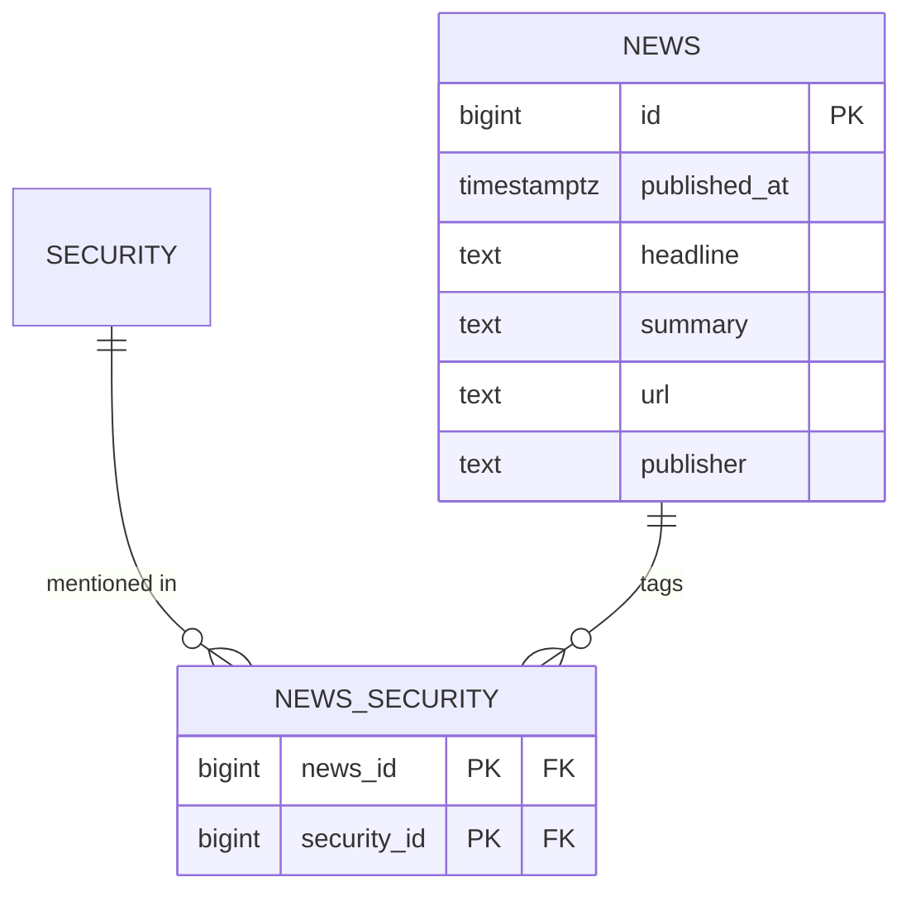

# Modelo de noticias — subsistema aparte, no fuente de verdad

Separado de `decisiones-modelo-ownership.md` §6 / `modelo-entidades-ownership.md`. Razón: la fuente de verdad de este proyecto se define por tres propiedades — se valida, se deriva, se reconcilia. Una noticia no tiene ninguna: no hay regla de sanidad sobre un titular, no hay nada que derivar de un artículo, no hay segunda fuente contra la que reconciliar un texto. Es un feed de contenido, no un dato financiero. Se documenta aparte para no mezclar naturalezas de dato bajo el mismo paraguas de rigor.

Reutiliza `SECURITY` (núcleo) solo como FK de unión, sin heredar su aparato de validación/point-in-time.

## Notas

- **Grano de etiquetado: SECURITY**, no LISTING ni COMPANY. Una noticia habla del negocio/instrumento, no de en qué bolsa cotiza ese día (no es LISTING); no se colapsa a COMPANY porque el proveedor etiqueta por símbolo/ISIN, y forzar el colapso exigiría decidir qué clase de acción es "la relevante" para cada noticia, lo cual no siempre es obvio en doble clase.
- Sin `reported_at_source`, sin bitemporalidad, sin reglas de validación: `published_at` es simplemente el dato del proveedor, tal cual.

## Abierto para discusión

- Si el proveedor etiqueta solo por ticker crudo (no por ISIN/security), la ingesta necesita resolver ticker→security antes de insertar en `NEWS_SECURITY` — mismo patrón de resolución de identidad que el resto del pipeline, pendiente de verificar contra el endpoint de noticias real de EODHD (no consultado aún).
- ¿Este subsistema vive en el mismo Postgres (misma base, tablas aparte) o se plantea desacoplado (otro store, ej. algo más orientado a texto/búsqueda)? A esta escala, misma base es razonable — lo marco como pregunta abierta, no como decisión tomada.
