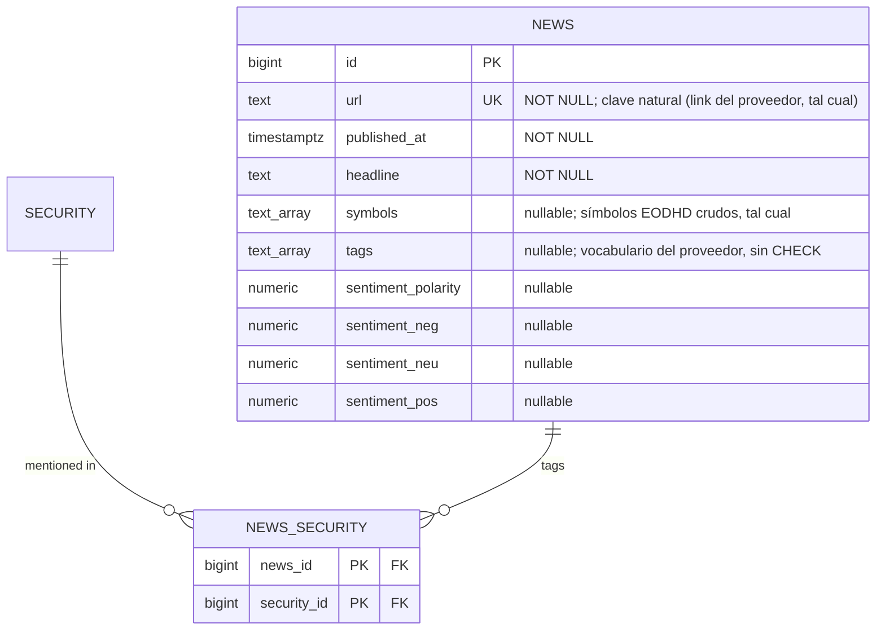

# Modelo de noticias — subsistema aparte, no fuente de verdad

Separado de `decisiones-modelo-ownership.md` §6 / `modelo-entidades-ownership.md`. Razón: la fuente de verdad de este proyecto se define por tres propiedades — se valida, se deriva, se reconcilia. Una noticia no tiene ninguna: no hay regla de sanidad sobre un titular, no hay nada que derivar de un artículo, no hay segunda fuente contra la que reconciliar un texto. Es un feed de contenido, no un dato financiero. Se documenta aparte para no mezclar naturalezas de dato bajo el mismo paraguas de rigor.

Reutiliza `SECURITY` (núcleo) solo como FK de unión, sin heredar su aparato de validación/point-in-time. **Sin auditoría** (`DIMENSION_AUDIT`) y **sin findings** (`DATA_QUALITY_FINDING`): nada de este subsistema entra en la capa de validación.

## Decisiones (P8, verificado contra payload real de `news`)

El payload de EODHD trae por artículo: `date`, `title`, `content`, `link`, `symbols[]`, `tags[]`, `sentiment{polarity, neg, neu, pos}`. No trae `summary` ni `publisher`.

1. **Clave natural: `url` NOT NULL UNIQUE.** Es el único identificador que da el proveedor (`link`). Sin url la fila no se puede deduplicar ni enlazar desde el front → criterio de NULL (identidad §8): sin ella la fila no significa nada, no se crea. Se guarda **tal cual**, sin normalizar (quitar query strings sería interpretación nuestra); si el mismo artículo llega con dos urls distintas, se aceptan dos filas.
   - Refetch = upsert por `url`: se actualizan en silencio `published_at`, `headline`, `tags`, `sentiment_*` y `symbols` (el proveedor puede recalcular sentimiento o corregir un titular; no es verdad financiera, no se audita).
   - `NEWS_SECURITY` solo **crece** (unión): un refetch añade enlaces, nunca borra.
2. **`published_at` y `headline` NOT NULL** (aprobado). Una noticia sin fecha o sin titular no es mostrable ni ordenable → no se crea.
3. **`content` no se almacena en v1. Tampoco `summary`.**
   - Es el texto íntegro de un tercero: almacenarlo y servirlo es redistribución de contenido con derechos ajenos, encima de lo que permita la licencia de EODHD. No soy abogado; es un riesgo a revisar antes de enseñar texto completo en el front, no algo que la tubería deba decidir por defecto.
   - En la muestra, 3 de 10 `content` son basura (paywall o truncado): no es fiable como resumen.
   - `summary` no existe en el payload → la columna se elimina (no se rellena truncando `content`: eso sería inventar un resumen).
   - El texto sigue disponible en `RAW_PAYLOAD` mientras dure su retención. Si más adelante se decide mostrar extracto, entra por migración nueva con la decisión legal tomada.
4. **`publisher` se elimina.** No viene en el payload, y sacarlo del dominio de `url` es derivable (→ VISTAS si hace falta) y además daría a menudo el agregador, no el medio original.
5. **`sentiment` como cuatro columnas `numeric` nullable** (`sentiment_polarity`, `_neg`, `_neu`, `_pos`), valor crudo del proveedor. No es derivable (es salida del modelo de EODHD) y es materia prima para atención de mercado. **Sin CHECK de rango**: es valor del proveedor y este subsistema no se valida.
6. **`tags` como `text[]` nullable**, vocabulario del proveedor sin CHECK.
7. **Símbolos fuera del universo.** El payload etiqueta por símbolo EODHD crudo (`AAPL.US`, `AAPL.MX`, `DJI.INDX`, `CL.COMM`, `OPAI.PVT`…).
   - `NEWS.symbols` guarda la lista cruda **tal cual** (dato del proveedor). Permite reenlazar más tarde cuando un valor entre en el universo, sin depender de la retención de `RAW_PAYLOAD`.
   - `NEWS_SECURITY` se puebla solo con los símbolos que resuelven por el **mismo crosswalk de símbolo que el resto de la ingesta** (símbolo EODHD → `LISTING` → `SECURITY`). Varios listings de la misma security (p. ej. `AAPL.US` + `AAPL.MX`) colapsan en una sola fila: el grano es SECURITY.
   - Los que no resuelven (índices, materias primas, privadas, listings fuera de universo) se **ignoran sin finding**: es lo esperado, no un problema de calidad.
   - **Tope de 50 símbolos por artículo:** el proveedor parece truncar ahí (dos artículos con exactamente 50). En esos artículos el enlazado puede ser incompleto; se acepta sin finding (suelen ser resúmenes de mercado de poco valor por valor individual).
   - El reenlazado desde `symbols` es un job futuro, no parte de la Fase 2.

## Notas

- **Grano de etiquetado: SECURITY**, no LISTING ni COMPANY. Una noticia habla del negocio/instrumento, no de en qué bolsa cotiza ese día (no es LISTING); no se colapsa a COMPANY porque el proveedor etiqueta por símbolo, y forzar el colapso exigiría decidir qué clase de acción es "la relevante" para cada noticia, lo cual no siempre es obvio en doble clase.
- Sin `reported_at_source`, sin bitemporalidad, sin reglas de validación: `published_at` es simplemente el dato del proveedor, tal cual.
- **Mismo Postgres, tablas aparte** (resuelto: así está la migración 009; a esta escala no se justifica otro store).
